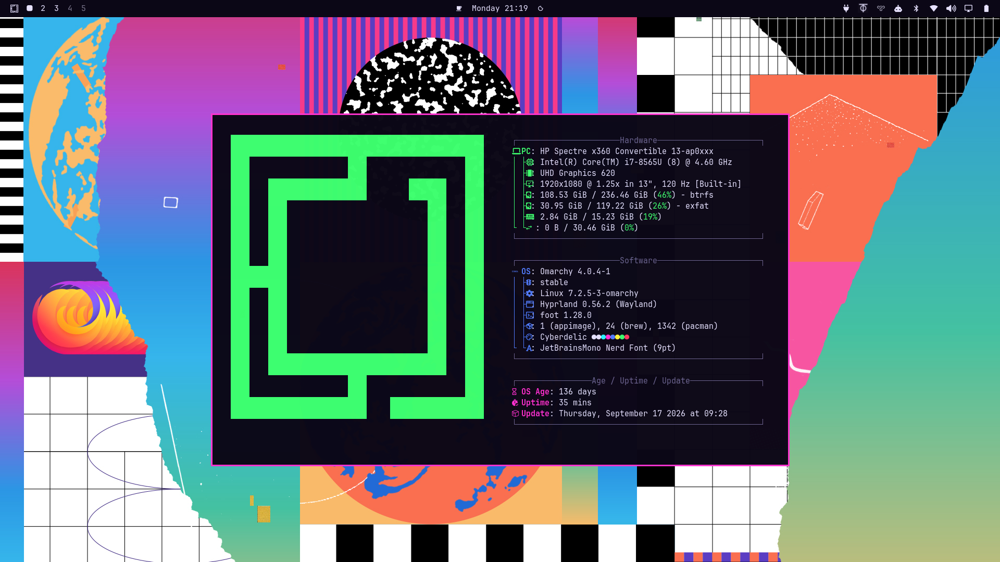

# Cyberdelic

An Omarchy theme channeling the "Silicon Dreams" era: *Wired* and *Mondo 2000* circa 1993–94, day-glo magenta and cyan on CRT-black, and the hypercolor optimism of the early commercial internet.



## Installation

```
omarchy-theme-install https://github.com/jwhall/omarchy-cyberdelic-theme.git
```

Or via Walker: `SUPER+ALT+SPACE` → Install → Style → Theme → paste `https://github.com/jwhall/omarchy-cyberdelic-theme.git`

## Contents

- `colors.toml` — theme color scheme (indigo-black base, `#ff2fd0` magenta accent, neon ANSI palette)
- `icons.theme` — icon theme reference (`Yaru-magenta`)
- `backgrounds/` — four 1920x1080 wallpapers
- `preview.png` — theme screenshot

## Wallpaper credits

Sourced from wallhaven.cc:

| File | Source |
| --- | --- |
| `1-collage.jpg` | https://wallhaven.cc/w/dg188o |
| `2-hypercolor-swirl.jpg` | https://wallhaven.cc/w/1kl6k1 |
| `3-vhs-atrium.jpg` | https://wallhaven.cc/w/6qoodl |
| `4-layered-glitch.jpg` | https://wallhaven.cc/w/gjjvyq |
